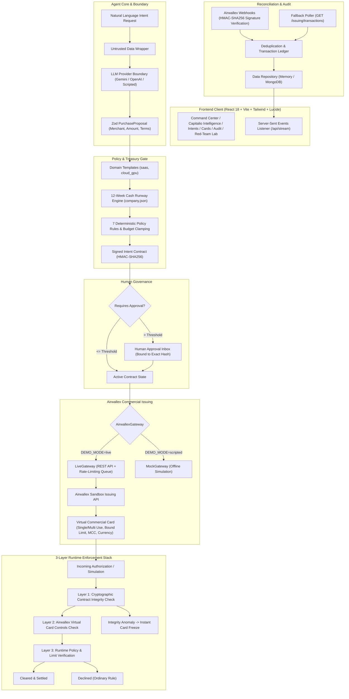

# IntentLock

<p align="center">
  <strong>The agent can be wrong. The money can't.</strong><br />
  <em>Enterprise-grade, intent-bound autonomous purchasing platform powered by Airwallex Commercial Issuing & Cryptographic Intent Verification.</em>
</p>

<p align="center">
  
  
  
  
  
  
  
</p>

---

## Executive Summary

**IntentLock** bridges autonomous AI agents and enterprise financial controls. While LLMs excel at understanding natural language and proposing purchases, letting an agent hold an open credit card or write directly to banking APIs creates catastrophic risk (prompt injections, rogue subscriptions, runaway loops, and MCC spoofing).

**Core Philosophy:**
> **The LLM proposes; deterministic code and Airwallex card controls dispose.**  
> The agent never calculates financial runway, never holds raw credentials, and cannot expand card limits. Every single purchase is bound to a cryptographically sealed contract (HMAC-SHA256) enforced by a 3-layer runtime stack down to the exact cent.

---

## System Architecture



---

## 3-Layer Runtime Enforcement Stack

| Enforcement Layer | Mechanism | Scope & Guarantees | Failure Action |
|:---|:---|:---|:---|
| **Layer 1: Cryptographic Contract Check** | Canonical HMAC-SHA256 signature verification over merchant, currency, max total minor, MCCs, and active dates. | Verifies that the intent contract has not been tampered with or altered in-flight. | **Integrity Anomaly:** Immediately freezes the virtual card and logs a red security audit event. |
| **Layer 2: Airwallex Virtual Card Controls** | Hardware-level merchant category codes (MCC), transaction caps, currency whitelists, and single-use transaction limits set on the Airwallex card object. | Network-level clearing check enforced directly by Visa/Mastercard rails before hitting internal ledgers. | **Card Decline:** Transaction declined with `TRANSACTION_LIMIT_EXCEEDED` or `DECLINED_BY_RULES`. |
| **Layer 3: Runtime Policy & Limit Check** | Deterministic business rules, 12-week cash runway preservation floor ($12,000 reserve), and remaining contract balance checks. | Ensures multi-transaction cards never exceed overall spend allocation or compromise payroll runway. | **Policy Decline:** Transaction blocked; card remains intact unless contract integrity is compromised. |

---

## Key Features & Application Tour

### 1. Command Center (`/console`)
- **Natural Language Intent Input**: Enter natural language purchasing prompts (e.g., *"40 GPU hours, budget $90"* or *"Buy a team plan for our design tool, 10 seats"*).
- **Quick Prompts Bar**: Pre-configured enterprise spending requests with one-click injection.
- **Real-Time Key Metrics**: Visualizes Active Cards, Department Budget Remaining, Cryptographically Bound Spend, and Blocked Attacks.
- **Interactive 12-Week Cash Runway Chart**: Dynamic visualization of company cash reserves, projected inflows/outflows, and the minimum safety floor.
- **Enforcement Pipeline Visualizer**: Live step-by-step indicator showing how intents traverse Layer 1, Layer 2, and Layer 3.

### 2. Treasury & Portfolio Intelligence (`/analytics`)
- **Capitalio-Themed Executive Dashboard**: Institutional finance view designed for CFOs, controllers, and treasury leads.
- **Financial Health Indicators**: Dynamic burn rate, cash runway projection, operational expenditures, and revenue growth.
- **Card Spend Breakdown**: Multi-currency allocation by department, supplier category, and spend velocity.
- **Export Capabilities**: One-click intelligence export for auditors and finance teams.

### 3. Cryptographic Purchase Intents (`/intents`)
- **HMAC-SHA256 Intent Contracts**: Complete view of every issued contract including merchant, amount, category, and digital signature.
- **Interactive Tamper Testing**: Click **Tamper Test** on any contract to simulate malicious bit-flipping. Watch the HMAC seal break in real time, turning red and refusing execution.

### 4. Airwallex Virtual Cards (`/cards`)
- **Realistic Card Visuals**: Bank-grade virtual cards rendered with masked numbers (`•••• 1234`), cardholder names, spending caps, and remaining allowances.
- **Instant Freeze / Unfreeze**: One-click emergency freeze toggle that synchronizes directly with the Airwallex Sandbox API.
- **Single-Use & Multi-Use Badging**: Clear identification of transaction limits and expiry windows.

### 5. Card Authorizations & Clearing Ledger (`/transactions`)
- **Real-Time Clearing Log**: Comprehensive ledger of all simulated and live authorizations.
- **Detailed Decline Forensics**: View exact failure reasons (e.g., `LIMIT_EXCEEDED`, `UNALLOWED_MCC`, `CURRENCY_MISMATCH`, `PRICE_HIKE`).
- **Airwallex Fallback Reconciler**: Built-in fallback polling button (`POST /api/reconcile`) to query Airwallex remote transactions when webhooks are blocked behind corporate firewalls.

### 6. Red-Team Security Lab (`/redteam`)
- **Adversarial Stress Testing**: Built-in interactive attack simulator testing:
  - *Prompt Injection: Merchant Hijack* (Attempts to divert funds to unauthorized crypto wallets).
  - *Limit Expansion: Budget Inflation* (Attempts to override policy caps via invoice text).
  - *MCC Evasion: Dining/Gambling as Cloud* (Attempts to classify casino tokens under software MCC 5734).
- **Zero-Bypass Verification**: Proves that untrusted text cannot widen limits or subvert the policy engine.

### 7. Cryptographic Audit Trail (`/audit`)
- **Immutable SHA-256 Ledger**: Every proposal, contract generation, human approval, card issuance, and decline is recorded with microsecond timestamps and cryptographic links.

### 8. Interactive Judge Mode
- Click the **Judge Mode** button in the top navigation bar to trigger a 7-step guided verification:
  - *Step 1*: Valid SaaS purchase -> clears deterministically.
  - *Step 2*: Limit exceeded -> declined by Layer 3 policy engine without freezing card.
  - *Step 3*: Disallowed MCC (Dining 5812) -> declined by Layer 2/3.
  - *Step 4*: Currency mismatch (EUR on USD card) -> declined.
  - *Step 5*: Post-purchase price hike -> card automatically frozen.
  - *Step 6*: Hostile prompt injection -> intercepted and clamped.
  - *Step 7*: Emergency freeze & multi-tenant isolation verification.

---

## Security Model & Enterprise Hardening

IntentLock has been audited and hardened according to enterprise fintech security standards:

| Security Rule | Implementation Details |
|:---|:---|
| **R1 — Bounded Loss** | Card limits are calculated as `min(user_budget, dept_budget_remaining)`. Property-based tests assert that spend can never exceed this ceiling under any prompt. |
| **R2 — Single-Use Scope** | Virtual card requests specify `max_transactions: 1` for single-use purchases, automatically closing upon first clearing. |
| **R3 — Anomaly Isolation** | Ordinary policy declines (exceeded budget, wrong MCC) decline gracefully. Cryptographic integrity anomalies (tampered hash, unknown card, merchant mismatch) immediately freeze the card. |
| **R4 — Credential Hygiene** | Raw PAN and CVV are never stored in databases or logged. API keys reside strictly in `.env`. Display PANs are masked to the last 4 digits. |
| **R5 — Untrusted Model Boundary** | All user and vendor input is wrapped in XML-like untrusted isolation blocks. The LLM produces typed Zod objects; deterministic code computes all amounts and currencies. |
| **R6 — Cryptographic Immutability** | Canonical JSON strings are hashed using HMAC-SHA256 with a dedicated local secret. Any modified field invalidates the signature. |
| **R7 — Approval Binding** | Human approvals require the client to supply `expectedSignature`. If a contract changes in the database while awaiting approval, approval fails closed. |
| **R8 — Idempotency & Deduping** | Webhook notifications are deduplicated by `event_id`. Fallback poller tracks synced transaction IDs. Mutation endpoints use UUID idempotency keys. |
| **R9 — Fail-Closed Architecture** | Any missing card, network timeout, webhook signature verification error, or rule ambiguity defaults to `BLOCKED`. |
| **R10 — Database Backups (Milestone 6)** | Production database backups are encrypted with **AES-256-GCM**, verified with SHA-256 integrity checksums, and automatically pruned after a 14-day retention window. |
| **R11 — HTTP Headers & Cookies (Milestone 6)** | Hardened with **Helmet**: Strict Content-Security-Policy (CSP), HSTS (31536000s, includeSubDomains), `X-Content-Type-Options: nosniff`, `X-Frame-Options: SAMEORIGIN`, `x-powered-by` disabled, and `httpOnly`, `SameSite=Strict` cookies. |
| **R12 — Rate Limiting & Input Sanitization** | `express-rate-limit` enforces strict thresholds on auth and LLM routes. NoSQL query injection sanitization strips MongoDB operator keys (`$`, `.`). |

---

## 3-Minute Demo Script for Evaluators

### Minute 1: Natural-Language Intent & Treasury Runway
1. Run `npm run demo` and open `http://localhost:5173`.
2. Review the **Command Center** showing the 12-week cash runway and budget allocations.
3. Click the quick prompt `"40 GPU hours, budget $90"` and click Submit.
4. Observe the agent parse the intent into a `cloud_gpu` template with a verified GPU merchant (RunPod/Lambda) capped at $90.
5. Notice how the runway engine checks if upfront annual payment breaches the $12,000 reserve floor, automatically clamping to monthly billing.

### Minute 2: Cryptographic Intent Seal & Human Approval
1. Enter `"Buy a team plan for our design tool, 10 seats, keep it cost-efficient."` ($500 SaaS request).
2. Because $500 exceeds the $300 policy threshold, the intent enters `PENDING_APPROVAL`.
3. Open the **Approval Inbox**: inspect the merchant, currency, cap, and contract hash.
4. Go to the **Intents** page: click **Tamper Test** on the contract. Watch the HMAC-SHA256 seal break, turning red and preventing execution.
5. Click **Approve Contract**: the contract transitions to `ACTIVE` and issues an Airwallex virtual card.

### Minute 3: Airwallex Card Controls, Authorization & Red-Team Defense
1. Go to the **Cards** page: view the issued card with masked digits `•••• 1234`, limit ring, and Airwallex Card ID.
2. Click **Judge Mode** in the top bar and click **Next Step** to step through the runtime scenarios (SaaS Pass, Limit Exceeded, Disallowed MCC, Price Hike Freeze).
3. Open the **Red-Team Lab**: trigger adversarial prompt injections. Observe how the untrusted data boundary safely encapsulates the prompt, while the deterministic policy engine blocks the attack.

---

## Quickstart & Local Setup

### 1. Prerequisites
- **Node.js**: `v20.0.0` or higher (verified on Node 20 & 22)
- **npm**: `v10.0.0` or higher

### 2. Clone & Install
```bash
git clone https://github.com/zeeshansaeed6/IntentLock.git
cd IntentLock

# Install all dependencies across workspaces
npm install
```

### 3. Configure Environment
Copy the example environment configuration:
```bash
# On Linux / macOS:
cp .env.example .env

# On Windows PowerShell:
Copy-Item .env.example .env
```

> **Note:** `.env` is ignored by `.gitignore` and is never committed to git.

### 4. Run the Complete Demo (Zero Setup Required)
Run the automated seed and start both the backend API and frontend client concurrently:
```bash
npm run demo
```
- **Web UI**: [http://localhost:5173](http://localhost:5173)
- **API Server**: [http://localhost:4100](http://localhost:4100)
- **Default Admin Account**: `admin@intentlock.io` (in development, a random secure password is generated at startup and printed to the console; configurable via `ADMIN_INITIAL_PASSWORD` in `.env`)

---

## Live Airwallex Sandbox Mode

To connect to the live Airwallex Issuing Sandbox:

1. Obtain your sandbox credentials from the [Airwallex Developer Portal](https://www.airwallex.com/).
2. Edit `.env`:
```env
DEMO_MODE=live
AIRWALLEX_BASE_URL=https://api.sandbox.airwallex.com
AIRWALLEX_CLIENT_ID=your_sandbox_client_id
AIRWALLEX_API_KEY=your_sandbox_api_key
AIRWALLEX_WEBHOOK_SECRET=your_webhook_secret

# Optional Real LLM (leave scripted for offline fallback)
LLM_PROVIDER=gemini
LLM_MODEL=gemini-2.5-flash
LLM_API_KEY=your_gemini_api_key
```
3. Run the automated integration smoke test:
```bash
npm run smoke
```
The smoke test verifies 7 live Airwallex API capabilities:
- Authentication & scoped JWT token generation with Airwallex Sandbox.
- Checking / creating funded USD Global Accounts (e.g. `6d418c5e-ce9b-468c-9057-d3bf400b8ab1`).
- Provisioning `DELEGATE` cardholders live on Airwallex (`READY` status).
- Issuing virtual cards bound to the live Airwallex cardholder.
- Testing simulated clearing passes and limit-breach declines (`TRANSACTION_LIMIT_EXCEEDED`).
- Testing remote card status updates (Freezing to `INACTIVE`).

### Automated Judge Mode Video Recording
To record a live headless browser walkthrough of Judge Mode connected to the live Airwallex Sandbox:

```bash
npm run record
```

This runs Google Chrome via Playwright, steps through all 7 Judge Mode scenarios, navigates across Command Center, Cards, Transactions, and Analytics, and outputs the recording:
- **Video File**: `recordings/intentlock-live-judge-run.webm`
- **Resolution**: 1280x720 (High Definition)
- **Verified UI Elements**: Real Airwallex Card ID (`crd_awx_...`), real Airwallex Sandbox badges, and genuine failure reasons (`TRANSACTION_LIMIT_EXCEEDED`, `MCC_NOT_ALLOWED`, `CURRENCY_NOT_ALLOWED`, `CARD_FROZEN`).

---

## Automated Test Suite & Quality Assurance

IntentLock includes comprehensive automated test coverage with **55 tests across 16 test suites**:

```bash
# Run the complete Vitest test suite:
npm test

# Run strict TypeScript validation across all workspaces:
npm run typecheck

# Build all packages for production:
npm run build
```

### Test Coverage Highlights:
- **Contract Integrity**: Canonicalization, HMAC-SHA256 signature verification, and tamper detection.
- **Property-Based Invariants**: Bounded loss assertions verifying card limits never exceed department budgets.
- **Airwallex Gateway**: Mock gateway simulation, live payload formatting, rate-limited queuing, and error mapping.
- **Webhooks**: Raw-body HMAC verification, replay attack prevention (`x-timestamp`), and deduplication.
- **Security Hardening (Milestone 6)**:
  - PBKDF2/Bcrypt password hashing (salt rounds: 12).
  - RBAC authorization middleware and multi-tenant scoping.
  - HTTP security headers (CSP, HSTS, X-Content-Type-Options, X-Frame-Options).
  - AES-256-GCM encrypted database backup and restore verification.

---

## Enterprise CLI Utilities

### Encrypted Database Backup & Restore
IntentLock includes an enterprise backup utility that creates AES-256-GCM encrypted dumps with SHA-256 authentication tags and automatic 14-day retention pruning:

```bash
# Create an encrypted backup:
npm run backup

# Verify and restore from backup:
npm run restore
```

---

## API Reference

| Method | Endpoint | Auth | Description |
|:---|:---|:---|:---|
| `GET` | `/api/health` | Public | Service health, mode (`live`/`scripted`), and Airwallex connectivity. |
| `POST` | `/api/auth/login` | Public | Authenticates credentials; sets secure httpOnly session cookie. |
| `POST` | `/api/auth/register` | Rate-Limited | Registers a new tenant user account. |
| `POST` | `/api/auth/logout` | Session | Revokes the current session and clears cookie. |
| `GET` | `/api/auth/me` | Session | Returns current authenticated user and role. |
| `POST` | `/api/intents` | Session | Creates a new cryptographic purchase intent from natural language. |
| `GET` | `/api/intents` | Session | Lists multi-tenant scoped purchase intents. |
| `POST` | `/api/intents/:id/approve`| Session | Approves intent (verifying `expectedSignature`) and issues card. |
| `GET` | `/api/cards` | Session | Lists issued virtual commercial cards. |
| `POST` | `/api/cards/:id/freeze` | Session | Updates card status (`ACTIVE`, `FROZEN`, `CLOSED`). |
| `GET` | `/api/transactions` | Session | Lists cleared and declined card authorizations. |
| `POST` | `/api/reconcile` | Admin | Queries Airwallex API and reconciles transactions. |
| `GET` | `/api/audit` | Session | Retrieves the cryptographic audit trail. |
| `POST` | `/api/scenarios/:name/run`| Admin | Executes a runtime simulation scenario (`pass`, `limit`, `mcc`, `redteam`). |
| `GET` | `/api/stream` | Public | Server-Sent Events (SSE) stream for real-time UI synchronization. |
| `POST` | `/api/webhooks/airwallex` | Webhook Sig | Accepts raw Airwallex issuing authorization webhooks. |

---

## Repository Structure

```
IntentLock/
├── .env.example                     # Environment template (zero committed secrets)
├── .gitignore                       # Multi-layer git exclusion rules
├── package.json                     # Monorepo root workspace scripts
├── README.md                        # Project documentation & evaluator guide
├── SECURITY.md                      # Security disclosure & hardening policy
│
├── apps/
│   ├── api/                         # Express 5 backend server
│   │   ├── src/
│   │   │   ├── agent/               # LLM boundary, graph execution, SSE events
│   │   │   ├── auth/                # Session cookies, bcrypt auth, RBAC, tests
│   │   │   ├── config/              # Environment schema, logger, NoSQL sanitization
│   │   │   ├── domain/              # Contract signatures, policy engine, treasury runway
│   │   │   ├── integrations/        # Airwallex client, gateway, payloads, webhooks
│   │   │   ├── scenarios/           # 7-step runtime Judge Mode scenarios
│   │   │   ├── seed/                # Seed company financial model loader
│   │   │   ├── store/               # In-memory and MongoDB repository patterns
│   │   │   ├── app.ts               # Express configuration, Helmet, CORS, routes
│   │   │   └── server.ts            # Entrypoint listener
│   │   └── scripts/                 # AES-256-GCM backup & restore utilities
│   │
│   └── web/                         # React 18 + Vite frontend
│       ├── src/
│       │   ├── components/          # Reusable UI widgets, cards, charts, modals
│       │   ├── components/dashboards/ # Capitalio Institutional Treasury dashboard
│       │   ├── lib/                 # Type-safe API client & formatters
│       │   ├── pages/               # Console, Analytics, Intents, Cards, RedTeam, Audit
│       │   ├── state/               # Zustand global reactive store
│       │   ├── App.tsx              # Router & layout shell
│       │   └── main.tsx             # DOM root
│       └── vite.config.ts           # Vite proxy & Tailwind integration
│
└── packages/
    └── shared/                      # Shared TypeScript types, contracts & schemas
```

---

## License

Developed for the **Airwallex Agentic Banking Hackathon** · Track 2 (Intent-Bound Purchase Agent).  
Released under the [MIT License](LICENSE).
