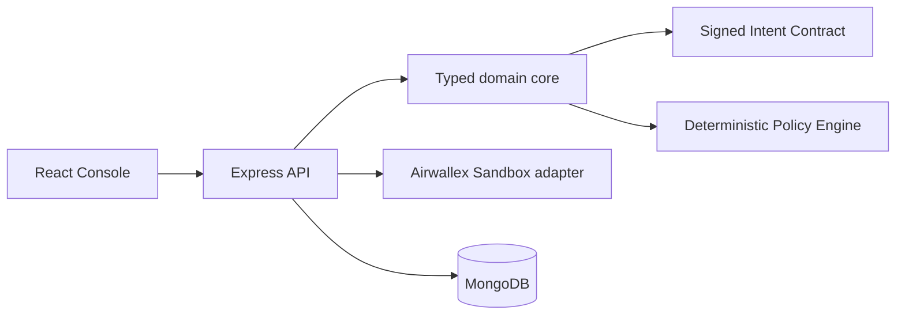

# IntentLock

IntentLock is an intent-bound purchase agent for the Airwallex sandbox. It turns a natural-language purchase request into a signed, bounded contract and enforces that contract through policy, card controls, and authorization checks.

> **The agent can be wrong. The money can't.**

## Quick start

```bash
npm install
copy .env.example .env
npm run dev
```

Open [http://localhost:5173](http://localhost:5173). Milestone 1 runs with seeded placeholder data and does not require sandbox credentials or MongoDB.

## Architecture



## Demo script

1. Launch the console and submit: “Buy a team plan for our design tool, 10 seats, keep it cost-efficient.”
2. Point out the deterministic runway chart: annual billing crosses the reserve floor in week 7, so the graph chooses monthly.
3. Open the live trace: the proposal is violet, while the policy gate, signed contract, and card issuance are deterministic green steps.
4. Run **Judge mode**. It demonstrates a passing charge, limit/MCC/currency declines, a hostile invoice prompt injection, and a price-hike revision that freezes the old card before issuing a replacement.
5. Explain that the browser sees only masked card data and contract/audit metadata.

## Security model

- **R1 bounded loss:** card limit is `min(intent budget, policy remaining)` in integer minor units.
- **R2 single-use scope:** contract-bound MCC, currency, expiry, transaction count, per-transaction and all-time limits.
- **R3 authorization verification:** every simulated authorization is checked against the signed contract; violations create an anomaly and freeze the card.
- **R4 credential isolation:** API keys, bearer tokens, PAN, and CVV remain server-side; UI uses only masked card details.
- **R5 untrusted LLM:** scripted proposals enter the typed graph; external text cannot call Airwallex directly.
- **R6 immutability:** stable canonical JSON plus HMAC-SHA256; changing a field invalidates verification.
- **R7 approval binding:** approval transitions only the exact stored contract.
- **R8 idempotency:** mutating Airwallex calls generate UUID request IDs; uncertain calls must be checked before retry.
- **R9 fail closed:** missing contract, card, signature, state, time, or allowlist checks deny and freeze.
- **R10 secrets hygiene:** `.env` is ignored and `.env.example` contains names only.

## Airwallex integration and limitations

The REST adapter is sandbox-only and remains gated until `AIRWALLEX_CLIENT_ID` and `AIRWALLEX_API_KEY` are present. Exact card fields are isolated in `apps/api/src/integrations/airwallex/payloads.ts`. The app uses scripted/local execution by default so the judge demo is deterministic without network or LLM variance. A live cardholder/card/simulation smoke run requires a funded sandbox Global Account and credentials; run it only after configuring `.env`.

The authorization demo is intentionally local/scripted until the sandbox smoke path is enabled. Real-time remote authorization is not claimed. Webhooks verify HMAC against raw request bytes and deduplicate event IDs; use a tunnel for local delivery, with transaction polling as the fallback integration path.
