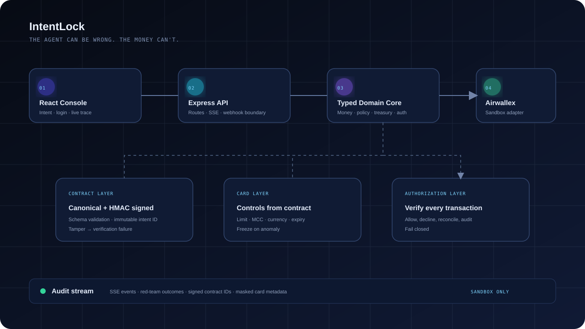

# IntentLock

<p align="center">
  <strong>The agent can be wrong. The money can't.</strong><br />
  An intent-bound purchase agent for the Airwallex sandbox.
</p>

<p align="center">
  <a href="https://github.com/zeeshansaeed6/IntentLock"></a>
  
  
  
</p>

IntentLock lets a user describe what they need to buy. The agent proposes a plan, deterministic code evaluates the financial consequences, and a signed Intent Contract becomes the spending boundary. A virtual card and every authorization check enforce that boundary.

> **Core principle:** The LLM proposes. Deterministic code and the card dispose.

## Contents

- [Why IntentLock](#why-intentlock)
- [Product flow](#product-flow)
- [Architecture](#architecture)
- [Key capabilities](#key-capabilities)
- [Quick start](#quick-start)
- [Using the demo](#using-the-demo)
- [Airwallex sandbox setup](#airwallex-sandbox-setup)
- [Environment variables](#environment-variables)
- [API reference](#api-reference)
- [Security model](#security-model)
- [Project structure](#project-structure)
- [Testing and quality checks](#testing-and-quality-checks)
- [Known limitations](#known-limitations)
- [License](#license)

## Why IntentLock

Most payment agents stop at “the model selected a payment.” IntentLock makes the financial decision explicit and enforces it in layers:

1. **Contract layer** — validates a typed proposal, applies deterministic policy, canonicalizes the contract, and signs it with HMAC-SHA256.
2. **Card layer** — derives limits, allowed MCCs, currencies, and the validity window from the signed contract.
3. **Authorization layer** — verifies each authorization against the contract, records the result, and freezes the card on anomalies.

The result is a purchase agent with a provable worst-case loss bound rather than an instruction in a prompt.

## Product flow

```text
Natural-language request
          │
          ▼
Interpret → Treasury projection → Policy gate
                                      │
                       ┌──────────────┴──────────────┐
                       │                             │
                 Human approval                 Safe denial
                       │                             │
                       ▼                             ▼
                Sign contract → Issue bounded card
                                      │
                                      ▼
                         Verify every authorization
                                      │
                                      ▼
                           Reconcile audit trail
```

### Hero scenario

A founder wants a 10-seat SaaS team plan. Annual billing is cheaper, but it pushes cash below the reserve floor in week seven. IntentLock calculates the 12-week projection in deterministic code, chooses monthly billing, signs the decision, and issues a card whose controls match the contract.

The Judge Mode story then demonstrates:

- A valid authorization that clears.
- A `LIMIT_EXCEEDED` decline.
- A `MERCHANT_CATEGORY_NOT_ALLOWED` decline.
- A `CURRENCY_NOT_ALLOWED` decline.
- A prompt-injection attack that cannot raise the limit.
- A price-hike revision that freezes the old card before issuing a replacement.

## Architecture



IntentLock is an npm-workspaces monorepo. The browser talks only to the application API. Airwallex credentials, bearer tokens, card payloads, and raw card data remain server-side.

| Layer | Responsibility | Implementation |
| --- | --- | --- |
| Web | Landing page, login, console, trace, cards, transactions, audit, red-team lab | React 18, Vite, TypeScript, CSS, Lucide |
| API | Auth, intents, scenarios, SSE, audit, webhook boundary | Express 5, Zod, Helmet, CORS |
| Domain | Money, treasury, policy, contract signing, authorization | Strict TypeScript, pure functions |
| Integration | Airwallex login, queue, retry, issuing, simulation, webhook verification | Fetch adapter behind one interface |
| Persistence | Demo state and audit data | In-memory store for local scripted mode |

## Key capabilities

### Interactive console

- Open demo login: any valid email and any non-empty password.
- Command Center with 12-week monthly-versus-annual runway projection.
- Live SSE agent trace with violet proposal steps and green/rose deterministic verdicts.
- Intent list with signed contract IDs, decision, state, cap, and signature preview.
- Card list with masked numbers, remaining limit, status, and freeze/unfreeze controls.
- Transaction list with merchant, MCC, amount, result, and decline reason.
- Audit Trail with JSON export.
- Red-Team Lab with individual attack buttons and a full Judge Mode run.

### Deterministic financial controls

- Integer minor-unit money calculations.
- `C = min(B_intent, B_policy_remaining)` card limit calculation.
- Annual/monthly/defer treasury recommendation.
- All policy failures returned together.
- Contract IDs derived from canonical JSON hashes.
- HMAC-SHA256 verification fails after any contract mutation.
- Authorization fails closed for missing, expired, frozen, tampered, or out-of-scope contracts.

### Airwallex sandbox adapter

- Login token cache with expiry refresh.
- Request queue with concurrency control and 429 backoff.
- UUID request IDs for mutating calls.
- Centralized card-create payload builder.
- Cardholder, virtual card, limits, freeze/update, simulation, capture, reverse, refund, and transaction methods.
- Raw-byte webhook HMAC verification and event deduplication.
- `npm run smoke` for credentialed sandbox verification.

## Quick start

### Requirements

- Node.js 20 or newer.
- npm 10 or newer.
- Airwallex credentials are **not required** for scripted local demo mode.

### Install and run

```bash
git clone https://github.com/zeeshansaeed6/IntentLock.git
cd IntentLock
npm install
copy .env.example .env
npm run dev
```

Open **http://localhost:5173**.

On macOS/Linux, use:

```bash
cp .env.example .env
```

The development command starts:

- Web app: `http://localhost:5173`
- API: `http://localhost:4100`

## Using the demo

1. Click **Sign in** on the landing page.
2. Use any valid email, for example `demo@example.com`, and any password.
3. Click **Launch Console**.
4. Submit the default SaaS request or select the cloud GPU example.
5. Watch the live trace update through SSE.
6. Open **Cards**, **Transactions**, and **Audit Trail** from the sidebar.
7. Open **Red-Team Lab** and run an individual attack or **Judge Mode**.
8. Use **Export JSON** in Audit Trail to download the current audit data.

### Suggested 3-minute presentation

| Time | Demonstration |
| --- | --- |
| 0:00–0:30 | Explain that the model proposes but never holds spending authority. |
| 0:30–1:10 | Submit the SaaS intent and show the reserve-floor decision. |
| 1:10–1:40 | Show the signed contract, card cap, MCC, currency, and expiry controls. |
| 1:40–2:20 | Run Judge Mode and call out the distinct decline reasons. |
| 2:20–2:45 | Run the prompt-injection attack and show policy rejection plus card enforcement. |
| 2:45–3:00 | Show the price-hike replacement, frozen old card, and reconciled audit trail. |

## Airwallex sandbox setup

IntentLock is designed for the Airwallex sandbox only. Never configure production credentials.

1. Create or access a sandbox business at [sandbox.airwallex.com](https://sandbox.airwallex.com).
2. Copy the Client ID and API key from **Account → Developer → API keys**.
3. Put them in `.env`; never commit `.env`.
4. Ensure a USD Global Account exists and fund it for the demo.
5. Run the smoke command:

```bash
npm run smoke
```

The smoke flow logs in, finds or creates a USD Global Account, simulates funding, creates a delegate cardholder, creates a virtual card, and runs one simulated authorization. It exits with a clear configuration error when credentials are missing.

The exact payload mapping is centralized in [`apps/api/src/integrations/airwallex/payloads.ts`](apps/api/src/integrations/airwallex/payloads.ts). The adapter follows the sandbox guide’s major-unit convention at the Airwallex boundary while the domain stores integer minor units.

## Environment variables

Copy `.env.example` to `.env`:

| Variable | Required | Description |
| --- | --- | --- |
| `NODE_ENV` | No | `development`, `test`, or `production`; defaults to `development`. |
| `API_PORT` | No | API port; defaults to `4100`. |
| `WEB_ORIGIN` | No | Allowed frontend origin; defaults to `http://localhost:5173`. |
| `DEMO_MODE` | No | `scripted` or `live`; defaults to `scripted`. |
| `AIRWALLEX_BASE_URL` | No | Sandbox API base URL. |
| `AIRWALLEX_CLIENT_ID` | Live only | Airwallex sandbox Client ID. |
| `AIRWALLEX_API_KEY` | Live only | Airwallex sandbox API key. |
| `AIRWALLEX_WEBHOOK_SECRET` | Webhooks | HMAC secret for webhook signatures. |
| `LLM_PROVIDER` | No | Provider selector; scripted mode is the reliable demo default. |
| `LLM_MODEL` | No | Optional live model name. |
| `INTENT_HMAC_SECRET` | No | Local signing secret; use a strong secret outside demo mode. |
| `MONGODB_URI` | Future persistence | Reserved for durable persistence. |

## API reference

All application endpoints are prefixed with `/api`.

### Authentication

| Method | Route | Description |
| --- | --- | --- |
| `POST` | `/api/auth/login` | Open demo login with `{ email, password }`. |
| `GET` | `/api/auth/me` | Resolve a demo bearer token. |
| `POST` | `/api/auth/logout` | Revoke a demo session. |

### Intents and execution

| Method | Route | Description |
| --- | --- | --- |
| `POST` | `/api/intents` | Create an intent from `{ userRequest }`. |
| `GET` | `/api/intents` | List signed intent records. |
| `GET` | `/api/intents/:id` | Retrieve one intent. |
| `POST` | `/api/intents/:id/approve` | Approve a pending contract. |
| `POST` | `/api/intents/:id/reject` | Reject a pending contract. |
| `POST` | `/api/intents/:id/revoke` | Revoke a contract. |
| `POST` | `/api/scenarios/:name/run` | Run `pass`, `limit`, `mcc`, `currency`, `redteam`, `pricehike`, or `judge`. |

### Observability and controls

| Method | Route | Description |
| --- | --- | --- |
| `GET` | `/api/health` | API mode and Airwallex configuration health. |
| `GET` | `/api/overview` | Dashboard metrics and runway data. |
| `GET` | `/api/cards` | List masked demo cards. |
| `POST` | `/api/cards/:id/status` | Set `ACTIVE`, `FROZEN`, or `CLOSED`. |
| `GET` | `/api/transactions` | List authorization results. |
| `GET` | `/api/audit` | List audit entries. |
| `GET` | `/api/stream` | Server-Sent Events live trace. |
| `POST` | `/api/webhooks/airwallex` | Verify and deduplicate raw Airwallex webhook events. |

Example intent request:

```bash
curl -X POST http://localhost:4100/api/intents \
  -H "Content-Type: application/json" \
  -d "{\"userRequest\":\"Buy a team plan for our design tool, 10 seats\"}"
```

## Security model

IntentLock encodes the ten rules from the build brief:

| Rule | Enforcement |
| --- | --- |
| R1 — bounded loss | Card limit is the deterministic minimum of intent and policy budgets. |
| R2 — single-use scope | MCC, currency, count, expiry, per-transaction, and all-time constraints are contract-bound. |
| R3 — authorization verification | Every authorization is checked against the contract; anomalies freeze the card. |
| R4 — credential isolation | Tokens, API keys, PAN, and CVV never enter browser state or model context. |
| R5 — untrusted model | External text is treated as data and only typed proposals enter the graph. |
| R6 — contract immutability | Stable canonical JSON plus HMAC-SHA256 detects mutation. |
| R7 — approval binding | Approval transitions the exact stored contract, not a later variation. |
| R8 — idempotency | Mutations use request IDs and uncertain operations must be checked before retry. |
| R9 — fail closed | Missing or unverifiable security conditions deny the authorization. |
| R10 — secrets hygiene | `.env` is ignored and only variable names are committed in `.env.example`. |

## Project structure

```text
IntentLock/
├── apps/
│   ├── api/
│   │   └── src/
│   │       ├── agent/                 # scripted graph and SSE events
│   │       ├── auth/                  # open demo session flow
│   │       ├── config/                # Zod environment validation
│   │       ├── domain/                # money, contract, policy, treasury
│   │       ├── enforcement/           # authorization verification
│   │       ├── integrations/airwallex # sandbox adapter and webhooks
│   │       ├── scenarios/             # Judge Mode scenario runner
│   │       └── store/                 # local demo state
│   └── web/
│       └── src/
│           ├── App.tsx                # landing, login, console, sections
│           ├── styles.css             # landing and console design system
│           └── console.css             # interactive workspace styles
├── docs/assets/architecture.svg       # README architecture image
├── packages/shared/                   # shared Zod schemas and types
├── .env.example
├── package.json
└── README.md
```

## Testing and quality checks

```bash
npm run typecheck
npm run test
npm run build
npm run seed
npm run smoke       # requires Airwallex sandbox credentials
```

The test suite covers:

- Exact integer money conversion.
- Contract canonicalization, signing, and tamper failure.
- Policy failures and bounded card limits.
- Monthly/annual/defer treasury decisions.
- Airwallex status mapping.
- Raw webhook signatures and duplicate delivery.
- Scripted Judge Mode outcomes and card freezing.

## Known limitations

- Scripted mode uses an in-memory store so it is easy to run locally and reset between demos.
- The live Airwallex adapter is sandbox-only and requires credentials plus sandbox funding.
- Real-time remote authorization is not claimed; local authorization verification is the enforcement demo.
- Durable MongoDB persistence, production authentication, and a production LLM provider are extension points.
- Webhook delivery requires a public tunnel in local development; polling remains the fallback reconciliation approach.

## License

This project is provided for the Airwallex Agentic Banking Hackathon and sandbox demonstration purposes. Add a project license before distributing it as a reusable library.
